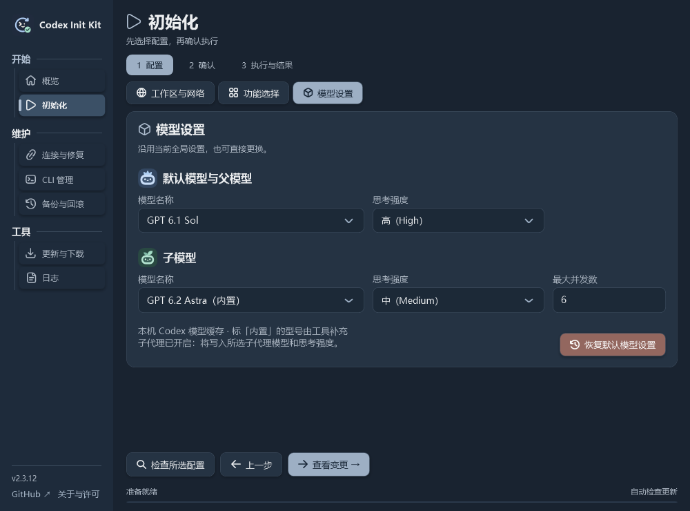
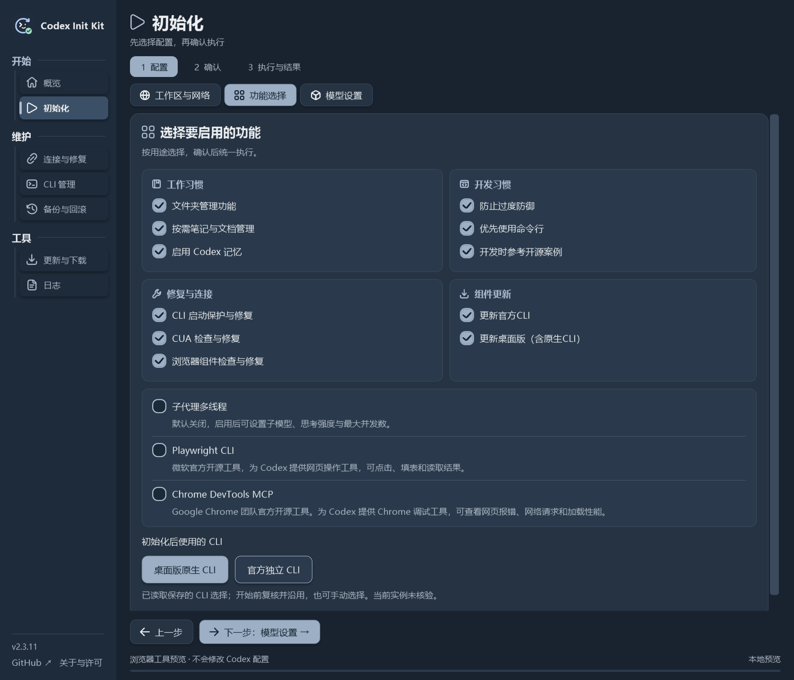
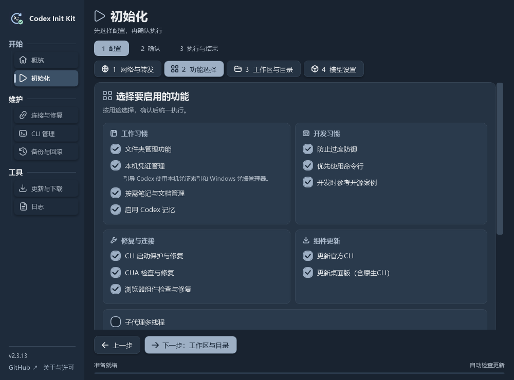
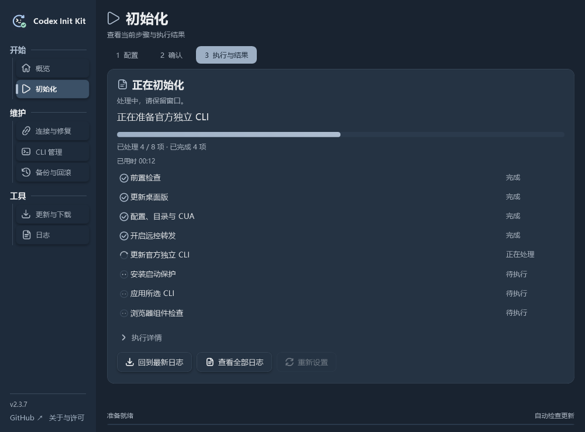
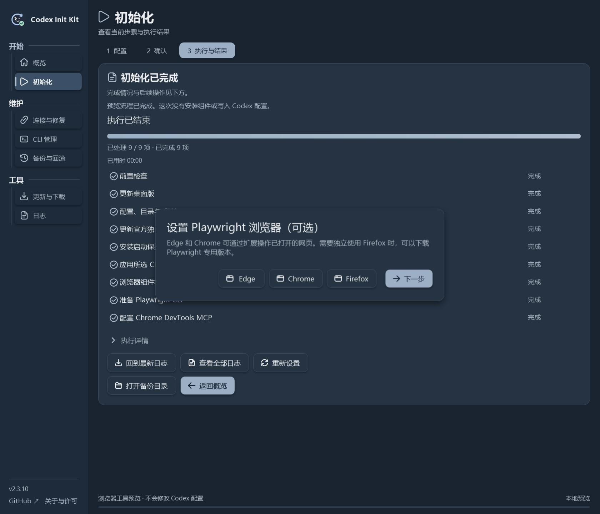
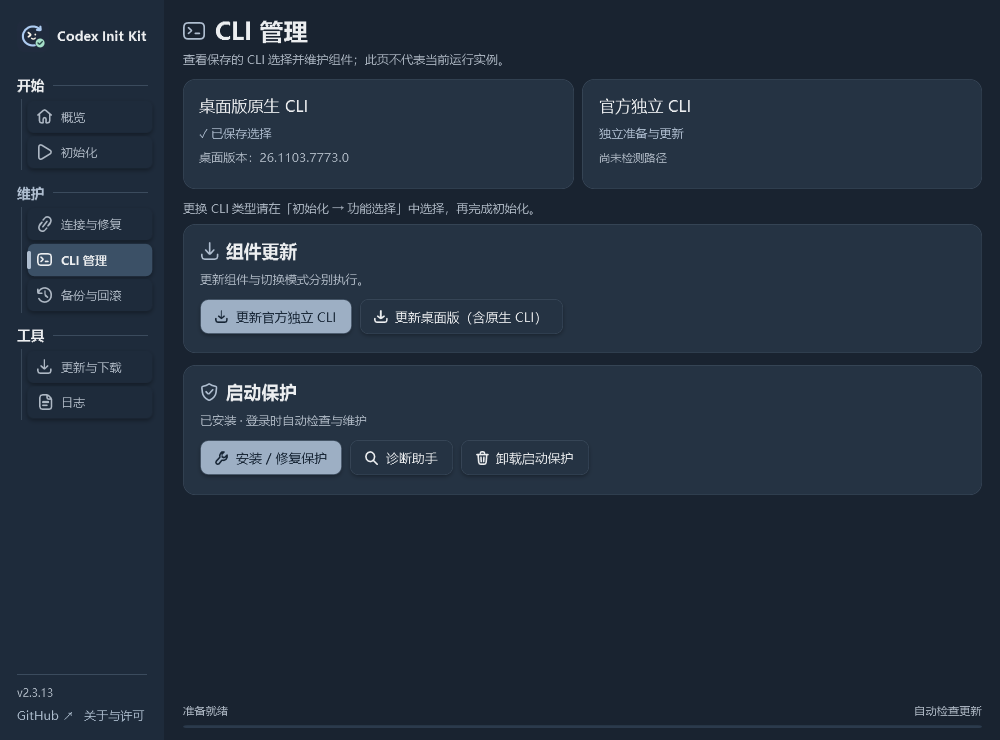
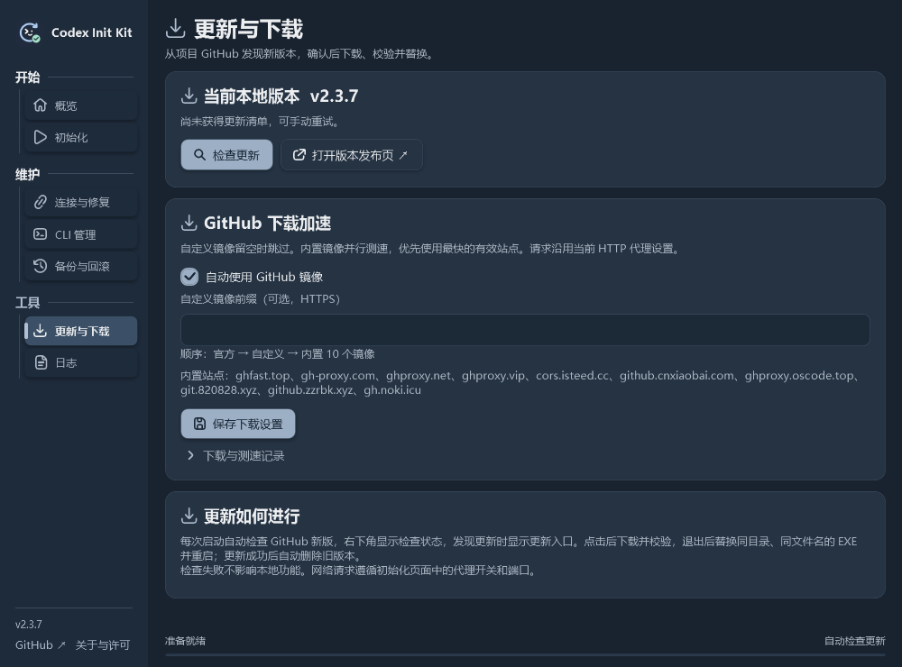
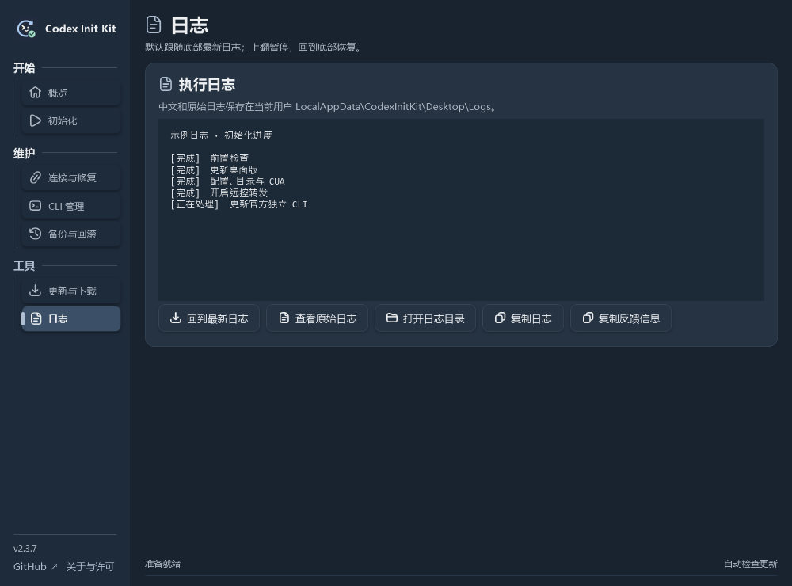

# Codex Init Kit · Windows 版 Codex 中文配置与修复工具

Codex Init Kit 是一个 Windows 中文桌面工具，用向导配置 OpenAI Codex 的工作目录、模型和 HTTP 代理。已经装好 Codex 的用户，可以直接排查 Chrome 连接、手机远控和桌面启动问题。

**[下载 CodexInitKit.exe](https://github.com/BerryFuwawa/codex-init-kit/releases/latest/download/CodexInitKit.exe)** · [Windows 使用手册](docs/Desktop.md) · [版本与更新记录](https://github.com/BerryFuwawa/codex-init-kit/releases)

Windows x64 · .NET Framework 4.8 · Windows PowerShell 5.1 · [v2.3.17 更新说明](docs/Release-2.3.17.md)

## 开始使用

1. 下载并双击打开 `CodexInitKit.exe`。
2. 首次配置时，点击「开始初始化」，依次设置网络、功能和模型。开启文件夹管理时，向导会多一步让你选择工作盘。确认页会列出本次变更。
3. 完成后，点「启动 Codex」或用原来的图标打开 Codex。如果有步骤未完成，可以先查看日志，再按结果页提示重试。

只想处理某个故障，可以直接打开「连接与修复」或「CLI 管理」。如果只需要配置代理，可以在向导里取消「开启远控转发」。[查看完整初始化选项](docs/Settings.md)

「工作习惯」可设置文件夹管理、本机凭证管理、按需笔记和 Codex 记忆。开启按需笔记后，Codex 会在分阶段工作或多轮排查时记录进度和下一步，方便换对话后接着做。本机凭证管理会引导 Codex 使用你电脑上已有的凭证索引和助手。「开发习惯」可让 Codex 在设计新功能时先参考开源案例。工具会记住你的选择。[可选功能](docs/Settings.md#可选功能)

## 解决常见问题

| 你遇到的问题 | 从这里开始 |
| --- | --- |
| **Codex 怎么设置 Karing、v2rayN 或自定义代理？** | 打开「连接与修复 → 连接状态」，选择预设，或填写代理软件当前的 HTTP 代理 IP 和端口，然后保存。重新打开 Codex 后可检查模型线路。[代理设置与检查](docs/WebSocket.md#配置与检查) |
| **关闭 TUN 后，手机上的 Codex Remote 或 Dot 找不到电脑** | 在「连接状态」开启远控转发。开启时需要管理员授权，工具会安装随 Windows 启动的服务并写入一条专用 hosts 映射。转发时请保持代理软件运行。[远控转发、换端口与卸载](docs/WebSocket.md#控制其他设备时使用远控转发) |
| **Codex 连不上 Chrome 或无法读取网页** | 打开「连接与修复 → 浏览器」，检查组件并按需修复。重新打开 Codex 后，用页面提供的测试指令读取网页标题。[Chrome 连接排查](docs/BrowserConnection.md) |
| **Codex 桌面版打不开，或提示「无法加载组织设置」** | 从「连接与修复 → 桌面启动」检查组件。需要改用官方独立 CLI 时，从「初始化 → 功能选择」选定并完成初始化。[桌面启动排查](docs/DesktopStartupRecovery.md) |
| **找不到 Codex CLI 或路径不对** | 在「CLI 管理」检查已保存的类型和路径。要更换 CLI 类型，请完成初始化。[CLI 管理说明](docs/Desktop.md#浏览器cli-与初始化顺序) |
| **电脑操作（CUA）组件缺失，或反复显示正在准备** | 打开「连接与修复 → 电脑操作」，检查缺失的组件，并按需补齐。[组件检查入口](docs/Desktop.md#遇到问题先选哪项) |
| **Codex 提示配置已弃用或无法识别** | 在「连接与修复 → 配置检查」查看具体警告，按提示处理。[配置兼容检查](docs/ConfigCompatibility.md) |
| **下载慢或工具更新失败** | 在「更新与下载」开启 GitHub 镜像重试，或从发布页手动下载。[下载设置](docs/GitHubMirrors.md) |

## 配置模型和子代理

- 在「初始化 → 模型设置」选择默认模型与思考强度。父模型和子模型都优先显示桌面版列出的型号。工具补充的型号标为「内置」，例如 GPT 6.2 Astra（内置）。同名型号沿用桌面版的思考强度，实际可用性取决于账号和客户端。[查看下拉框示例](assets/screenshots/v2.3.12/model-dropdown.png)
- 「子代理多线程」首次使用时默认关闭。在「功能选择」开启后，默认由 Codex 自动分工、选择模型和思考强度，也可手动指定。「最大并发数」默认为 **6**，可修改并保存。
- 点击「恢复默认模型设置」，可恢复父模型 GPT 6.2 Sol／中、子代理自动指派和并发上限 6。若本机列表缺少默认模型，会选择首个可用型号。确认并执行初始化后保存。[模型与档位说明](docs/Settings.md#模型)

## 按需添加浏览器工具

- **Playwright CLI** 适合让 Codex 点击、填表和读取网页。可直接使用已安装的 Chrome 或 Edge，也可以安装扩展来操作现有标签页。专用 Firefox 在你确认后才下载。
- **Chrome DevTools MCP** 适合查看 Chrome 网页报错、网络请求和加载性能。

两项都可以在「初始化 → 功能选择」中单独勾选。已安装的工具会自动识别，支持单独卸载。[浏览器工具说明](docs/Settings.md#浏览器工具)

## 备份与回滚

初始化会先备份需要改动的配置与全局规则，再按你的选择合并。**已有对话、项目文件和记忆文件会保留。** 如需回滚，先在「备份与回滚」核对备份时间。恢复配置会覆盖该文件在备份之后的编辑。[备份与回滚](docs/NativeInitializationReconcile.md#备份与回滚)

## 界面预览

查看其他界面

## 文档与反馈

- [中文使用手册](docs/Desktop.md) · [配置兼容检查](docs/ConfigCompatibility.md) · [日志查看与导出](docs/Logs.md)
- [用户资料和 Work 连接设置](docs/DesktopProfile.md) · [组件恢复与构建说明](docs/NativeDesktop.md) · [独立脚本](docs/Scripts.md)

反馈时请附上工具版本、操作步骤和错误信息。「日志」页可以复制反馈信息，分享前请检查其中的个人路径和账号等信息。[提交问题或功能建议](https://github.com/BerryFuwawa/codex-init-kit/issues)

## 源码与许可

Codex Init Kit 是社区维护的独立工具，采用 [MIT 许可](LICENSE)。在 Windows 上可从仓库根目录执行 `python .\tools\Build-Desktop.py`，生成 `build\desktop-native\CodexInitKit.exe`。[构建与验证说明](docs/Desktop.md#构建与验证边界)

发布版 EXE 暂未签名，可以用发布页的 `SHA256SUMS.txt` 核对下载文件。[查看发布文件](https://github.com/BerryFuwawa/codex-init-kit/releases/latest) · [火绒误报记录](docs/Release-2.2.13.md#验证与已知问题)
