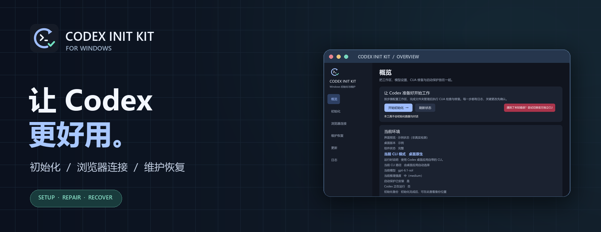
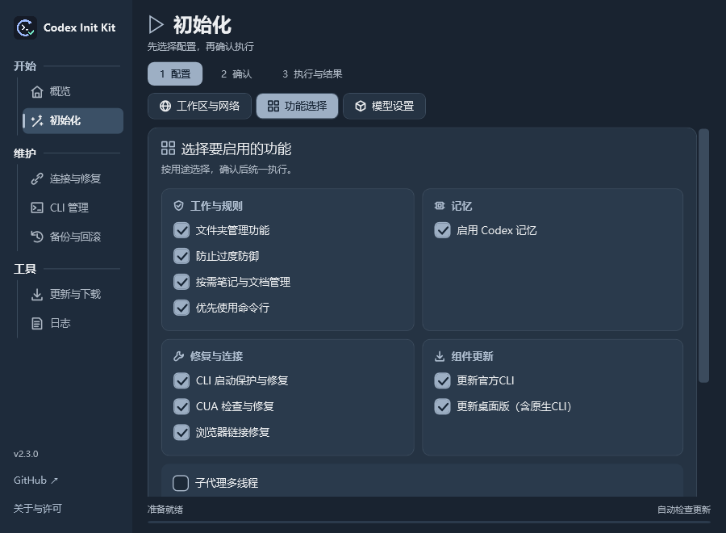
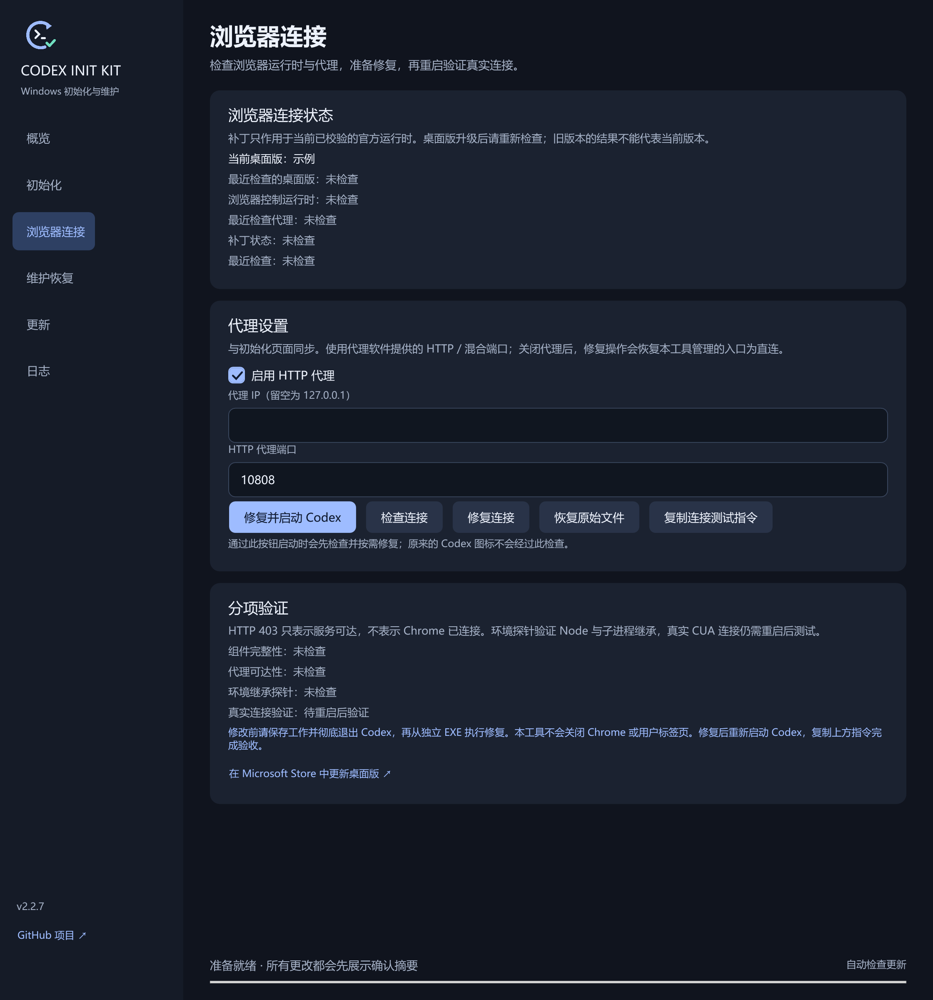
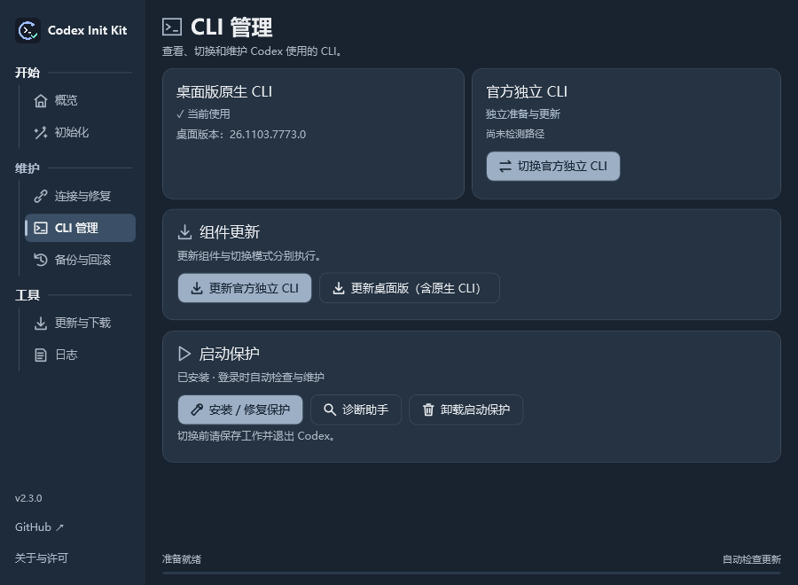
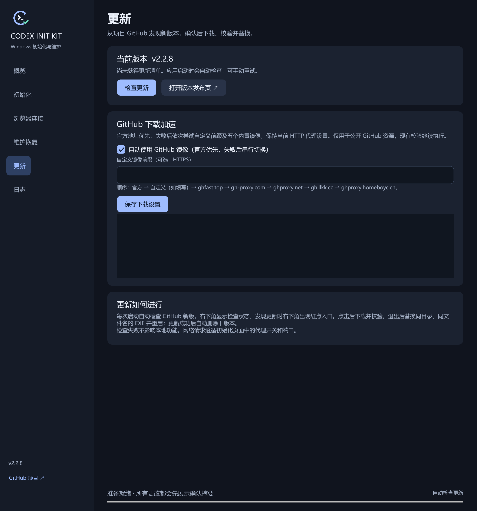
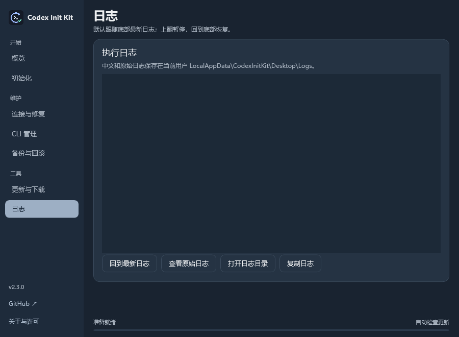

<div align="center">
  
</div>

# Codex Init Kit：Windows Codex 初始化与故障修复

**把配置、连接检查和日常维护，放进一个中文桌面工具。**

Codex Init Kit 面向 Windows 用户，帮助你初始化 Codex 工作环境、排查浏览器连接问题、检查 CUA 组件、切换官方 CLI，以及备份和恢复配置。第一次配置可以使用向导；已经在使用 Codex，也可以只运行需要的检查或单项修复。

<p align="center">
  <a href="https://github.com/BerryFuwawa/codex-init-kit/releases/latest"></a>
  
  
  
</p>

<p align="center">
  <strong><a href="https://github.com/BerryFuwawa/codex-init-kit/releases/latest/download/CodexInitKit.exe">⬇ 下载 Windows 桌面版</a></strong>
  &nbsp; · &nbsp; <a href="https://github.com/BerryFuwawa/codex-init-kit/releases/latest">最新版本与校验文件</a>
  &nbsp; · &nbsp; <a href="docs/Desktop.md">使用手册</a>
  &nbsp; · &nbsp; <a href="https://github.com/BerryFuwawa/codex-init-kit/issues">问题反馈</a>
</p>

<p align="center"><sub>Windows x64 · .NET Framework 4.8 · Windows PowerShell 5.1 · 公开版本 <a href="docs/Release-2.2.13.md">v2.2.13</a></sub></p>

本项目完全开源，初始化、维护和更新流程的源码均可在本仓库审阅。本机火绒出现过文件检测与 PowerShell 系统加固提示，正在申请官方复核。[查看检测说明](docs/Release-2.2.13.md#验证与已知问题)

> **你的对话和项目文件会保留。** 完整初始化会先备份，再重建用户配置和全局 `AGENTS.md`，并按选择修改代理、目录与 CLI 设置。旧的全局自定义规则保存在备份中；只需要排查某个问题时，无需完整初始化。

---

## 遇到这些问题？

| 你可能正在搜索 | 可以先试什么 |
| --- | --- |
| **🌐 Codex 连不上 Chrome / 浏览器控制不可用** | 打开「浏览器连接」，检查组件、代理和环境继承，按需修复并在重启后测试。[查看浏览器连接指南](docs/BrowserConnection.md) |
| **🖥️ Codex 桌面版打不开 / 无法加载组织设置** | 使用桌面原生 CLI 时，可尝试切换官方独立 CLI 后重启验证；若日志中有 `EPERM`、`rename_staging` 等特征，也可检查桌面启动组件。[查看操作方法](docs/DesktopStartupRecovery.md) |
| **🐢 Codex 启动很慢，并且运行的时候卡的不行，CUA 目录反复产生临时文件** | 在「维护恢复」检查电脑操作组件，按需补齐并校验当前版本的文件。[查看 CUA 说明](docs/Desktop.md#遇到问题先选哪项) |
| **🧩 Codex CLI 找不到、路径错误或启动异常** | 运行诊断，检查组件；也可在桌面原生 CLI 和官方独立 CLI 间切换。[查看 CLI 与维护说明](docs/Desktop.md#浏览器cli-与初始化顺序) |
| **🚀 刚安装 Codex，不知道怎样配置模型、代理和工作目录** | 从「初始化」选择功能，查看变更摘要，确认后一次完成。[查看初始化选项](docs/Settings.md) |
| **🛡️ Codex 防御性太强，总是重复校验、添加不必要的保护？** | 初始化时勾选默认开启的「防止过度防御」，将 HERO 中文完整规则和防御边界写入全局 `AGENTS.md`。[查看规则说明](docs/AntiOverDefense.md) |
| **🗂️ Codex 的对话工作文件、项目和交付物总是乱放？** | 初始化时勾选默认开启的「文件夹管理」，创建按用途分类的目录，约定无项目任务的存放位置；已有文件不会自动搬移。[查看初始化选项](docs/Settings.md#可选功能) |
| **💬 Codex 总是啰嗦、反复确认，不按你的要求推进？** | 初始化写入基础工作规则；勾选「防止过度防御」后还会加入自主推进与交付规则，引导它明确目标、简洁沟通，在常规决策中继续工作。[查看规则说明](docs/AntiOverDefense.md) |
| **📝 排查过的问题又从头试一遍？** | v2.2.9 的「按需笔记与文档管理」引导 Codex 记录可复用的失败条件、验证结果和替代方案，下次按索引查阅。[查看初始化选项](docs/Settings.md#按需笔记与文档管理) |
| **⌨️ 能用命令完成，却经常要你配合点界面？** | v2.2.9 的「优先使用命令行」引导 Codex 在授权范围内用 CLI 或 PowerShell 直接执行并核验。[查看初始化选项](docs/Settings.md#优先使用命令行) |

组件检查通过或补丁准备完成，只说明对应检查或准备步骤成功。浏览器需要重启 Codex 后实际打开并读取测试页面；账号权限、服务端和代理服务本身的问题也需分别排查。本版本开发时未完成真实 Chrome 连接验收，使用后请按步骤自行验证。[查看验证边界](docs/BrowserConnection.md#本次验证边界)

工作规则用于引导 Codex 的行为，实际效果还会受到具体任务、用户指令和项目规则的影响。

## 功能一览

| | |
| --- | --- |
| **🧭 中文初始化向导**<br>集中设置工作目录、HTTP 代理、模型、记忆与可选功能。修改前展示确认摘要，运行时可查看进度和日志。 | **🌐 浏览器连接检查与修复**<br>检查运行时、代理端口和环境继承；按需准备可恢复的修复，也可复制重启后的连接测试指令。 |
| **🧩 CUA 组件维护**<br>检查电脑操作组件，对照当前官方应用文件按需修复，帮助排查缺失、损坏或反复准备组件的问题。 | **🛠️ 桌面启动与 CLI 修复**<br>检查特定启动故障，选择桌面版原生 CLI 或官方独立 CLI；两种程序均来自 OpenAI。 |
| **🗂️ 文件夹与工作规则**<br>按需创建工作目录，设置无项目任务目录；可写入防止过度防御、子代理等全局规则。 | **↩️ 备份与回滚**<br>查看初始化备份和保护器 CLI 的可回滚版本与时间，选择目标并确认后恢复。不同恢复操作各有范围。 |
| **📋 中文日志与诊断**<br>查看状态、运行诊断、复制当前日志；中文解释和原始输出可切换，最新日志默认在底部。 | **⬇️ 更新与下载加速**<br>检查工具更新；公开 GitHub 资源支持官方优先、自动镜像回退和自定义 HTTPS 镜像前缀。 |

此外，可分别更新官方独立 CLI 与 Microsoft Store 桌面版；记忆和「防止过度防御」默认勾选，子代理多线程默认关闭。[查看全部初始化选项](docs/Settings.md)

## 下载后，三步开始

1. **下载并启动**：下载 [CodexInitKit.exe](https://github.com/BerryFuwawa/codex-init-kit/releases/latest/download/CodexInitKit.exe)，双击打开。所需脚本已包含在 EXE 中。
2. **先看概览**：查看当前环境；只想检查或修复时，直接进入「浏览器连接」或「维护恢复」。
3. **需要初始化时**：保存工作并退出 Codex，选择工作盘、代理和功能，在确认页核对模型及 CLI 模式后执行。v2.2.9 默认沿用检测到的 CLI 类型，也可手动选择。

初始化完成后会显示实际结果。部分步骤未完成时，可查看中文日志和具体项目，再单独重试。

<details>
<summary><strong>使用前：备份、数据与下载校验</strong></summary>

- 初始化不会清除已有对话记录或项目文件，也不会自动搬移已有工作文件。
- 完整初始化会备份并重建当前用户配置与全局 `AGENTS.md`。旧的全局自定义内容保存在本次备份中，不会自动写回；项目目录内的 `AGENTS.md` 不受这项全局重置影响。
- 可在「维护恢复」选择初始化备份或保护器 CLI 版本回滚。浏览器补丁、CUA 备份和启动保护各有单独的恢复范围。[查看恢复说明](docs/Desktop.md)
- 发布页提供 `SHA256SUMS.txt`。发布 EXE 当前未签名；请从本仓库的 [Releases](https://github.com/BerryFuwawa/codex-init-kit/releases) 获取并核对文件。

</details>

## 界面预览

<table>
  <tr>
    <td width="50%"><strong>初始化</strong><br>按需要选择代理、功能、CLI 和模型。<br><a href="assets/screenshots/settings.png"></a></td>
    <td width="50%"><strong>浏览器连接</strong><br>检查环境，修复后再验证真实连接。<br><a href="assets/screenshots/browser-connection.png"></a></td>
  </tr>
</table>

<details>
<summary><strong>查看更多页面：维护恢复、更新和日志</strong></summary>

**维护恢复**：检查与修复组件、切换 CLI、诊断以及选择备份回滚。



**更新**：查看工具版本，配置 GitHub 下载加速和自定义镜像。



**日志**：中文说明与原始输出可切换，按需复制和查看。



</details>

界面图片使用示例状态，实际检测结果以你的电脑为准。

## 常见问题

### Codex 连接不上 Chrome，应该从哪里开始？

先到「浏览器连接」检查组件完整性、代理端口和环境继承。如果使用代理，确认代理软件已启动，并填写它提供的 HTTP／混合端口。需要修复时先保存工作、退出 Codex；修复后重启并使用页面提供的测试指令实际读取网页。[详细步骤与恢复方法](docs/BrowserConnection.md)

### Codex 桌面版打不开或提示“无法加载组织设置”，怎么办？

如果当前使用桌面原生 CLI，可以先保存工作并退出 Codex，在「维护恢复」点击「切换官方独立 CLI」，然后重启 Codex 验证；组件缺失时工具会按需准备。日志中出现 `bundled_executable_relocation_failed`、`EPERM` 和 `rename_staging` 时，也可检查桌面启动组件。该提示可能有多种原因，切换 CLI 不保证解决所有情况。[桌面启动故障处理](docs/DesktopStartupRecovery.md)

### Codex 初始化会删除对话、项目或记忆吗？

不会清除已有对话、项目文件或已有记忆文件。完整初始化会备份并重建配置和全局 `AGENTS.md`，旧的全局自定义规则保存在备份里。如果只需要检查或单项修复，可以跳过完整初始化。[查看初始化说明](docs/Settings.md)

### 必须使用代理吗？

不需要。初始化中的 HTTP 代理默认开启，可按实际情况修改 IP 和端口，也可以取消勾选。工具不会安装或启动代理软件；浏览器页使用同一套代理设置。[查看代理设置](docs/Settings.md#代理开关)

### 初始化默认使用什么模型和 CLI？

父模型和子代理模型默认继承已有全局设置，未设置时使用 `gpt-6.1-sol / medium`。子代理默认关闭，模型实际可用性取决于账号和环境。v2.2.9 默认沿用检测到的桌面原生或官方独立 CLI，确认页会显示选择来源。[查看模型和 CLI 选项](docs/Settings.md)

### 下载很慢或更新失败怎么办？

工具的「更新」页支持 GitHub 自动镜像和自定义 HTTPS 镜像。按官方、自定义、内置十个镜像的顺序尝试，内置镜像并行测速。你也可以在 [Releases 页面](https://github.com/BerryFuwawa/codex-init-kit/releases)手动下载。镜像设置不改变系统代理，也不会接管微软商店或 OpenAI 安装器内部的网络行为。[查看镜像说明](docs/GitHubMirrors.md)

## 文档与反馈

- [桌面版使用手册](docs/Desktop.md) · [初始化选项](docs/Settings.md) · [v2.2.13 更新说明](docs/Release-2.2.13.md) · [v2.2.12 更新说明](docs/Release-2.2.12.md)
- [浏览器连接与 Chrome 验证](docs/BrowserConnection.md) · [桌面启动故障处理](docs/DesktopStartupRecovery.md) · [配置兼容检查](docs/ConfigCompatibility.md)
- [中文与原始日志](docs/Logs.md) · [GitHub 下载加速](docs/GitHubMirrors.md) · [防止过度防御](docs/AntiOverDefense.md)

遇到问题或希望补充功能，欢迎到 [Issues](https://github.com/BerryFuwawa/codex-init-kit/issues) 反馈。请描述现象、操作步骤和错误信息，并在分享日志前自行检查其中的个人路径、账号或其他敏感信息。

如果这个工具帮助到了你，也欢迎分享给遇到类似问题的朋友，或给项目点一颗 Star，让更多人找到它。

## 源码构建

在仓库根目录执行：

```powershell
powershell -ExecutionPolicy Bypass -File .\tools\Build-Desktop.ps1
```

输出为 `build\desktop\CodexInitKit.exe`。命令行验收、组件源码和构建说明见 [桌面版使用手册](docs/Desktop.md#构建与验证边界)与[脚本说明](docs/Scripts.md)。

Codex Init Kit 是社区维护的独立工具，并非 OpenAI 官方产品。
