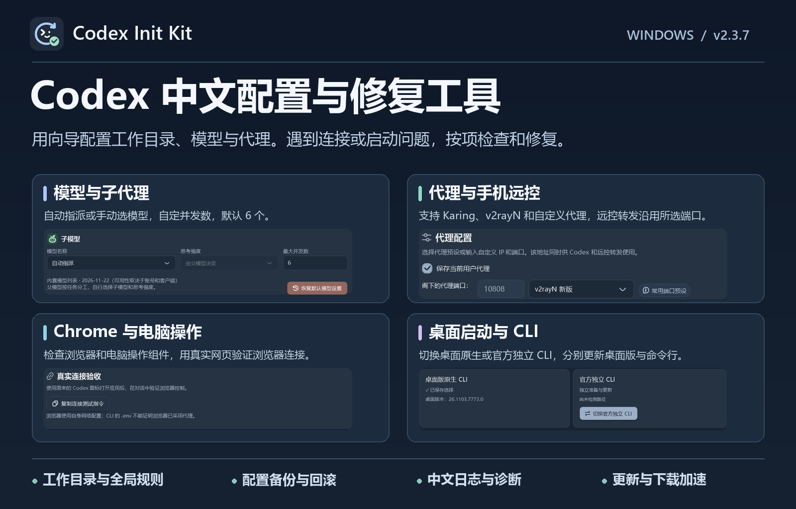
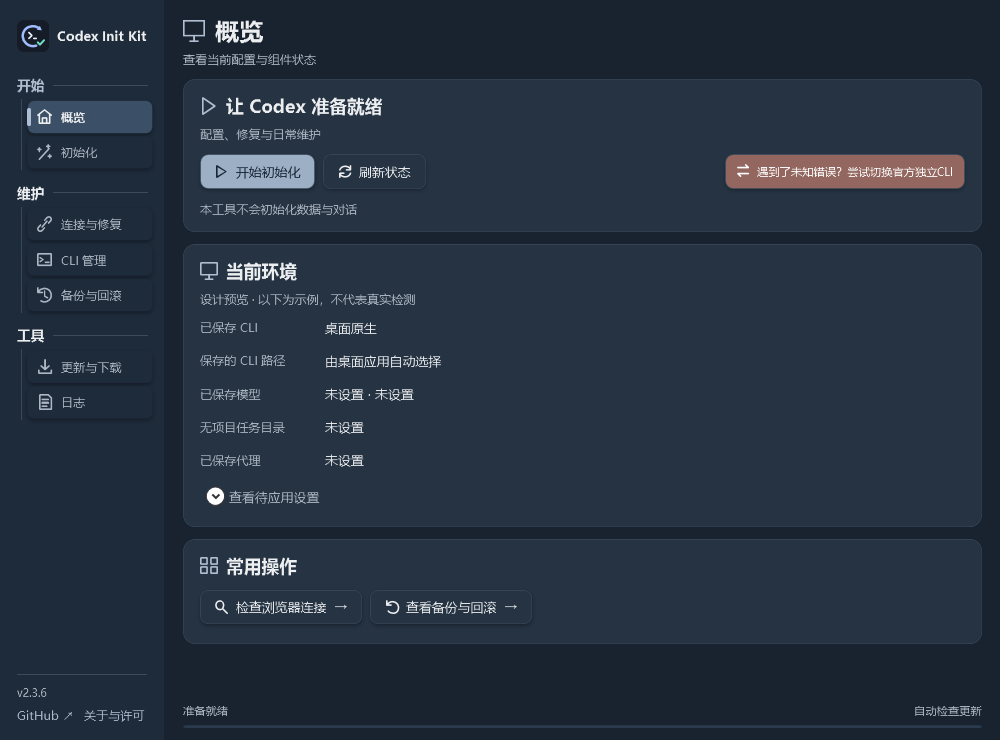
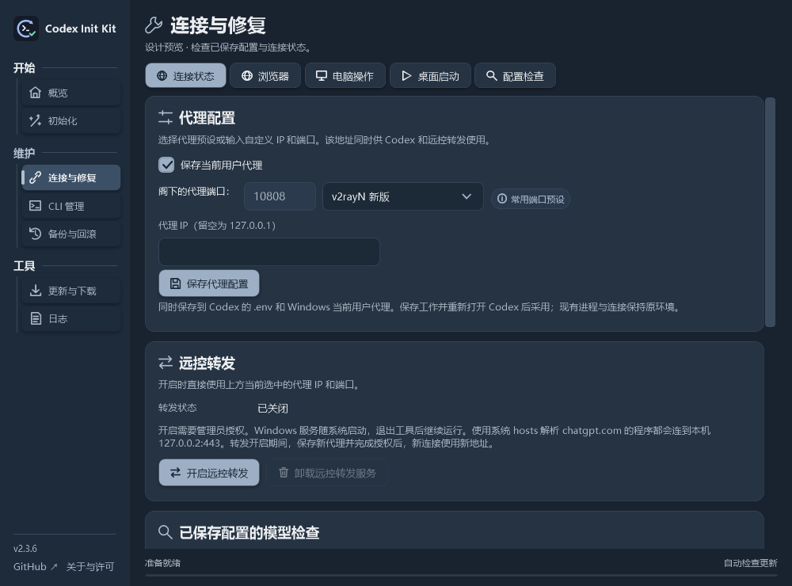
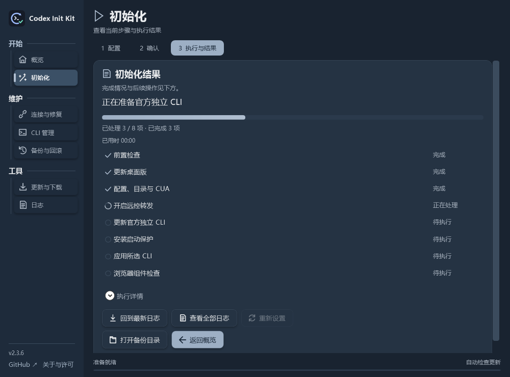
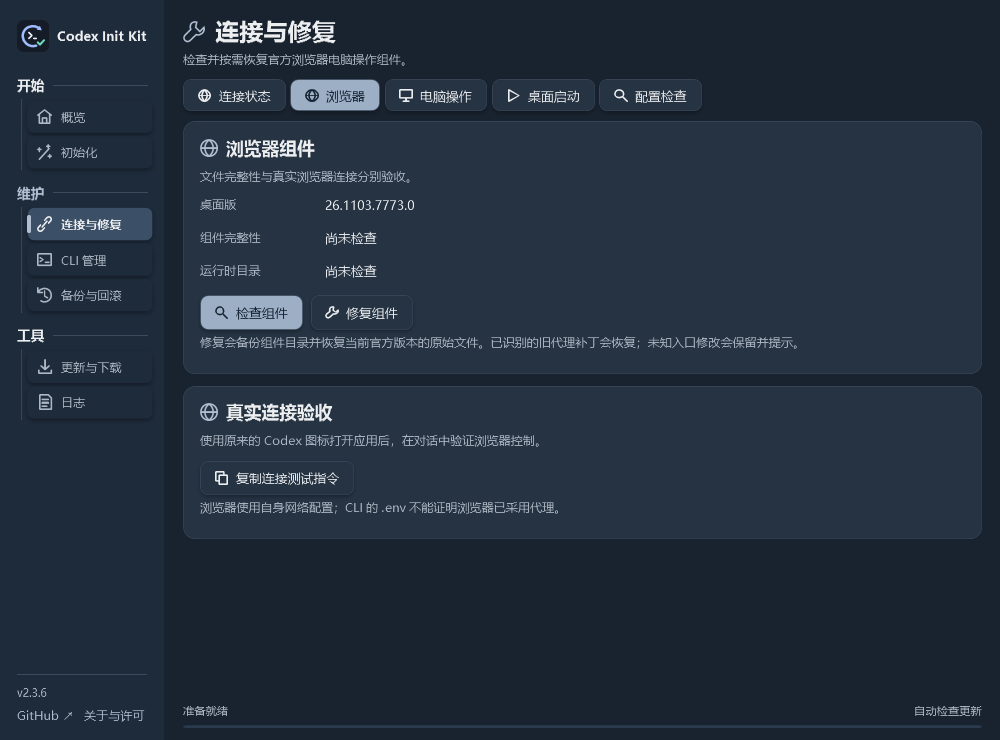
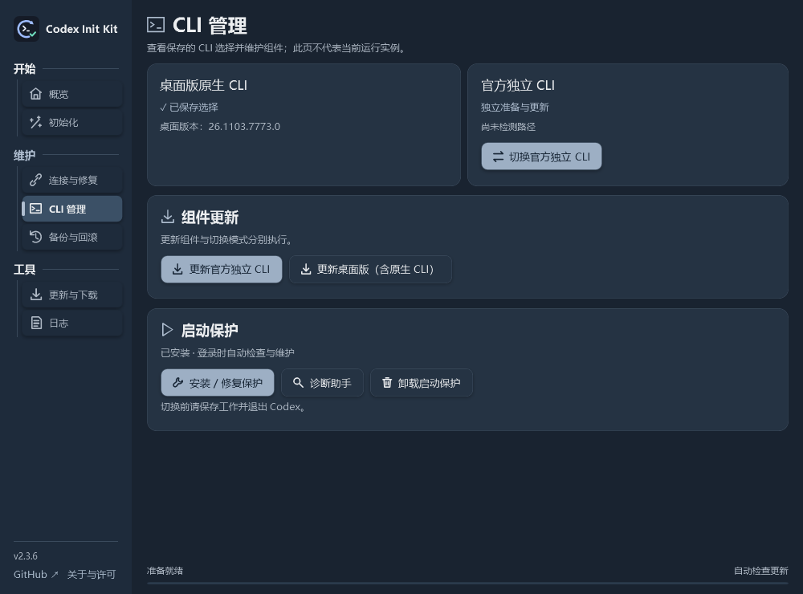
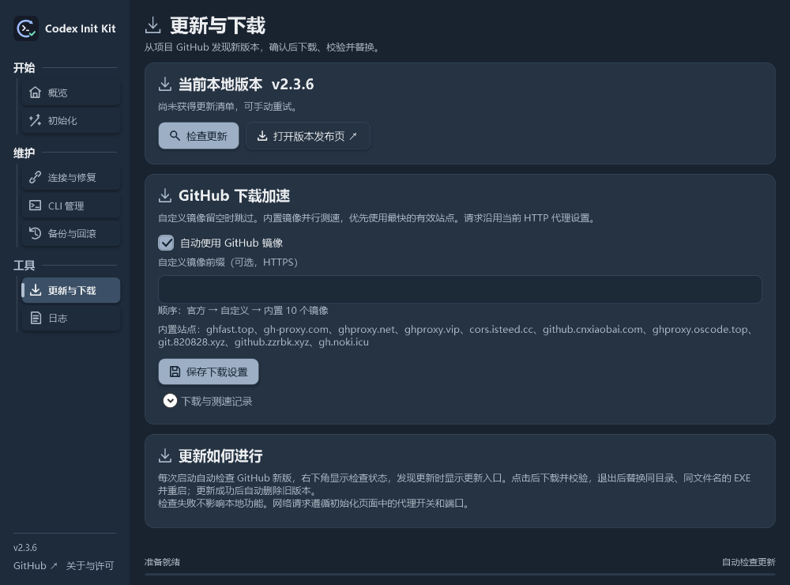
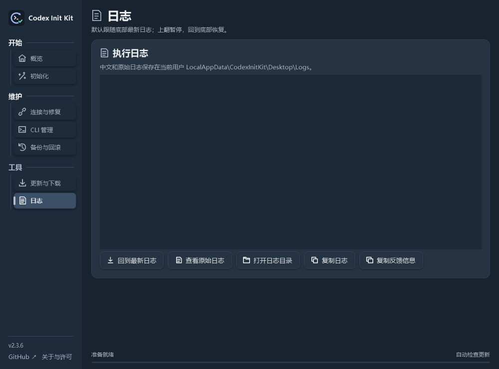

# Codex Init Kit · Windows 版 Codex 中文配置与修复工具

Codex Init Kit 是社区开发的 OpenAI Codex 初始化工具，提供简体中文界面。第一次在 Windows 上使用 Codex，可以用向导设置工作目录、模型和 HTTP 代理。已经装好 Codex 的用户，可以单独排查 Chrome 连不上、手机远控看不到电脑或桌面版打不开的问题。

<p align="center">
  <a href="https://github.com/BerryFuwawa/codex-init-kit/releases/latest"></a>
  
  
  
</p>

<p align="center">
  <strong><a href="https://github.com/BerryFuwawa/codex-init-kit/releases/latest/download/CodexInitKit.exe">下载 Codex Init Kit 中文版（Windows x64）</a></strong>
  &nbsp; · &nbsp; <a href="https://github.com/BerryFuwawa/codex-init-kit/releases/latest">最新版本与校验文件</a>
  &nbsp; · &nbsp; <a href="docs/Desktop.md">使用手册</a>
  &nbsp; · &nbsp; <a href="https://github.com/BerryFuwawa/codex-init-kit/issues">问题反馈</a>
</p>

<p align="center"><sub>Windows x64 · .NET Framework 4.8 · Windows PowerShell 5.1 · 当前版本 <a href="docs/Release-2.3.6.md">v2.3.6</a></sub></p>

<div align="center">
  
</div>

本项目使用 [MIT 许可](LICENSE)，初始化、维护和更新流程的源码均可在本仓库审阅。火绒安全实验室已于 2026-11-13 确认此前检测为误报，病毒库更新后可排除，并将优化相关 PowerShell 系统加固提示。[查看检测说明](docs/Release-2.2.13.md#验证与已知问题)

> **v2.3.6 · 子代理支持自动指派。** 开启多线程后，可让父模型按任务分工并选择档位，也可手动指定子模型与思考强度。下次打开会沿用上次保存的选择。[更新说明](docs/Release-2.3.6.md)

> **你的对话和项目文件会保留。** 初始化先备份需要修改的配置，再合并所选功能管理的内容。原有权限、未知配置和未管理的自定义规则保留；只需要排查某个问题时，可运行单项检查或修复。

---

## Windows 上的 Codex 连接与启动问题

| 使用时遇到的问题 | 在 Codex Init Kit 中怎么处理 |
| --- | --- |
| **Codex 怎么配置 Karing 或 v2rayN 代理？** | 打开「连接与修复 → 连接状态」，选择代理软件或填写它当前的 HTTP 代理 IP 和端口，点「保存代理配置」。[代理设置与模型线路检查](docs/WebSocket.md#配置与检查) |
| **关闭 TUN 后，手机上的 Codex Remote 或 Dot 看不到电脑** | 保持代理软件运行，在「连接与修复 → 连接状态」点「开启远控转发」，完成 Windows 授权，再刷新设备列表。[远控转发设置与卸载](docs/WebSocket.md#控制其他设备时使用远控转发) |
| **Codex 连不上 Chrome，无法控制浏览器** | 打开「连接与修复 → 浏览器」检查组件；需要时修复，再用测试标签页验证 Codex 能否读到网页标题。[Chrome 连接排查步骤](docs/BrowserConnection.md) |
| **🖥️ Codex 桌面版打不开 / 无法加载组织设置** | 使用桌面原生 CLI 时，可尝试切换官方独立 CLI 后重启验证；若日志中有 `EPERM`、`rename_staging` 等特征，也可检查桌面启动组件。[查看操作方法](docs/DesktopStartupRecovery.md) |
| **Codex 启动慢，CUA 目录反复生成临时文件** | 在「连接与修复 → 电脑操作」检查电脑操作组件，按需补齐当前版本的文件。[查看 CUA 说明](docs/Desktop.md#遇到问题先选哪项) |
| **🧩 Codex CLI 找不到、路径错误或启动异常** | 运行诊断，检查组件；也可在桌面原生 CLI 和官方独立 CLI 间切换。[查看 CLI 与维护说明](docs/Desktop.md#浏览器cli-与初始化顺序) |

## Codex 初始化与工作习惯

| 想调整什么 | 在初始化向导中怎么设置 |
| --- | --- |
| **🚀 刚安装 Codex，不知道怎样配置模型、代理和工作目录** | 从「初始化」选择功能，查看变更摘要，确认后一次完成。[查看初始化选项](docs/Settings.md) |
| **🛡️ Codex 防御性太强，总是重复校验、添加不必要的保护？** | 初始化时勾选默认开启的「防止过度防御」，将 HERO 中文完整规则和防御边界写入全局 `AGENTS.md`。[查看规则说明](docs/AntiOverDefense.md) |
| **🗂️ Codex 的对话工作文件、项目和交付物总是乱放？** | 初始化时勾选默认开启的「文件夹管理」，创建按用途分类的目录，约定无项目任务的存放位置；已有文件不会自动搬移。[查看初始化选项](docs/Settings.md#可选功能) |
| **💬 Codex 总是啰嗦、反复确认，不按你的要求推进？** | 初始化写入基础工作规则；勾选「防止过度防御」后还会加入自主推进与交付规则，引导它明确目标、简洁沟通，在常规决策中继续工作。[查看规则说明](docs/AntiOverDefense.md) |
| **📝 排查过的问题又从头试一遍？** | v2.2.9 的「按需笔记与文档管理」引导 Codex 记录可复用的失败条件、验证结果和替代方案，下次按索引查阅。[查看初始化选项](docs/Settings.md#按需笔记与文档管理) |
| **⌨️ 能用命令完成，却经常要你配合点界面？** | v2.2.9 的「优先使用命令行」引导 Codex 在授权范围内用 CLI 或 PowerShell 直接执行并核验。[查看初始化选项](docs/Settings.md#优先使用命令行) |

工作规则用于引导 Codex 的行为，实际效果还会受到具体任务、用户指令和项目规则的影响。

## 功能一览

| | |
| --- | --- |
| **模型与子代理**<br>沿用已有模型设置，或让父模型按任务分工并选择子模型与思考强度。 | **代理与手机远控**<br>保存 Karing、v2rayN 或自定义代理地址。开启远控转发后，新连接会使用当前保存的 IP 和端口。 |
| **🧭 中文初始化向导**<br>集中设置工作目录、HTTP 代理、模型、记忆与可选功能。修改前展示确认摘要，运行时可查看进度和日志。 | **🌐 浏览器连接检查与修复**<br>校验并按需恢复官方运行时文件，也可复制真实浏览器连接测试指令。 |
| **🧩 CUA 组件维护**<br>检查电脑操作组件，对照当前官方应用文件按需修复，帮助排查缺失、损坏或反复准备组件的问题。 | **🛠️ 桌面启动与 CLI 修复**<br>检查特定启动故障，选择桌面版原生 CLI 或官方独立 CLI；两种程序均来自 OpenAI。 |
| **🗂️ 文件夹与工作规则**<br>按需创建工作目录，设置无项目任务目录；可写入防止过度防御、子代理等全局规则。 | **↩️ 备份与回滚**<br>查看初始化备份和保护器 CLI 的可回滚版本与时间，选择目标并确认后恢复。不同恢复操作各有范围。 |
| **📋 中文日志与诊断**<br>查看状态、运行诊断、复制当前日志；中文解释和原始输出可切换，最新日志默认在底部。 | **⬇️ 更新与下载加速**<br>检查工具更新；公开 GitHub 资源支持官方优先、自动镜像回退和自定义 HTTPS 镜像前缀。 |

此外，可分别更新官方独立 CLI 与 Microsoft Store 桌面版；记忆和「防止过度防御」默认勾选，子代理多线程首次使用时关闭，之后沿用上次保存的开关。[查看全部初始化选项](docs/Settings.md)

## Windows 下载与初始化

1. **下载并启动**：下载 [CodexInitKit.exe](https://github.com/BerryFuwawa/codex-init-kit/releases/latest/download/CodexInitKit.exe)，双击打开。所需脚本已包含在 EXE 中。
2. **先看概览**：查看当前环境；只想检查或修复时，直接进入「连接与修复」→「浏览器」或「CLI 管理」。
3. **需要初始化时**：保存工作并退出 Codex，选择工作盘、代理和功能，在确认页核对模型及 CLI 模式后执行。v2.2.9 默认沿用检测到的 CLI 类型，也可手动选择。

初始化完成后会显示实际结果。部分步骤未完成时，可查看中文日志，再点“仅重试未完成项”。随后继续使用原来的 Codex 图标；新 CLI 进程自行读取保存的代理配置。电脑名称与允许控制可在 Codex/Work 中手动设置。

<details>
<summary><strong>使用前：备份、数据与下载校验</strong></summary>

- 初始化不会清除已有对话记录或项目文件，也不会自动搬移已有工作文件。
- 完整初始化会先备份需要变更的内容，再合并本次所选功能管理的配置和全局 `AGENTS.md` 规则，保留已有自定义内容；项目目录内的 `AGENTS.md` 不受全局规则更新影响。
- 可在「备份与回滚」选择初始化备份或保护器 CLI 版本回滚。CUA 组件目录备份和启动保护各有单独的恢复范围。[查看恢复说明](docs/Desktop.md)
- 发布页提供 `SHA256SUMS.txt`。发布 EXE 当前未签名；请从本仓库的 [Releases](https://github.com/BerryFuwawa/codex-init-kit/releases) 获取并核对文件。

</details>

## v2.3.6 界面预览

在「初始化 → 模型设置」选择「自动指派」，右侧思考强度会显示「由父模型决定」。选具体模型后，思考强度即可手动调整。








底部检查条从左侧滑入、从右侧完全滑出，窗口拉宽后也会走完整条轨道。




<details>
<summary><strong>查看更多页面：维护恢复、更新和日志</strong></summary>

**CLI 管理**：切换 CLI，分别更新两类组件，并管理启动保护。



**更新与下载**：查看工具版本，配置 GitHub 下载加速和自定义镜像。



**日志**：中文说明与原始输出可切换，按需复制和查看。



</details>

界面图片使用示例状态，实际检测结果以你的电脑为准。

## 常见问题

### Codex 连接不上 Chrome，应该从哪里开始？

先到「连接与修复」→「浏览器」检查组件完整性，需要时恢复官方文件。退出后使用原来的 Codex 图标重新打开，再用页面提供的测试指令实际读取网页。浏览器网络与 CLI 代理分别验收。[详细步骤与恢复方法](docs/BrowserConnection.md)

### Codex 桌面版打不开或提示“无法加载组织设置”，怎么办？

如果当前使用桌面原生 CLI，可以先保存工作并退出 Codex，在「CLI 管理」点击「切换官方独立 CLI」，然后重启 Codex 验证；组件缺失时工具会按需准备。日志中出现 `bundled_executable_relocation_failed`、`EPERM` 和 `rename_staging` 时，也可检查桌面启动组件。该提示可能有多种原因，切换 CLI 不保证解决所有情况。[桌面启动故障处理](docs/DesktopStartupRecovery.md)

### Codex 初始化会删除对话、项目或记忆吗？

不会清除已有对话、项目文件或已有记忆文件。初始化先备份需要修改的内容，合并工具管理的配置和规则，保留未管理的自定义内容。如果只需要检查或单项修复，可以跳过完整初始化。[查看初始化说明](docs/Settings.md)

### Codex 怎么使用 Karing、v2rayN 或自定义代理端口？

先打开代理软件，查看它当前的 HTTP 或混合代理监听端口。在「连接与修复 → 连接状态」选择对应预设；如果实际端口不同，就选「自定义代理端口」，填写实际 IP 和端口并保存。重新打开 Codex 后，可在同一页点「检查已保存的模型线路」。能直接联网的用户可以在初始化时取消勾选代理。[代理开关与端口设置](docs/Settings.md#代理开关)

### 初始化默认使用什么模型和 CLI？

父模型沿用全局设置，未配置时使用 `gpt-6.1-sol / medium`。子代理没有已保存的档位时默认选「自动指派」，已有手动档位会保留。CLI 默认沿用检测到的桌面原生或官方独立 CLI。[查看模型和 CLI 选项](docs/Settings.md)

### 下载很慢或更新失败怎么办？

工具的「更新与下载」页支持 GitHub 自动镜像和自定义 HTTPS 镜像。按官方、自定义、内置十个镜像的顺序尝试，内置镜像并行测速。你也可以在 [Releases 页面](https://github.com/BerryFuwawa/codex-init-kit/releases)手动下载。镜像设置不改变系统代理，也不会接管微软商店或 OpenAI 安装器内部的网络行为。[查看镜像说明](docs/GitHubMirrors.md)

## 文档与反馈

- [Windows 中文使用手册](docs/Desktop.md) · [Codex 初始化选项](docs/Settings.md) · [各版本更新记录](https://github.com/BerryFuwawa/codex-init-kit/releases)
- [浏览器连接与 Chrome 验证](docs/BrowserConnection.md) · [桌面启动故障处理](docs/DesktopStartupRecovery.md) · [配置兼容检查](docs/ConfigCompatibility.md)
- [中文与原始日志](docs/Logs.md) · [GitHub 下载加速](docs/GitHubMirrors.md) · [防止过度防御](docs/AntiOverDefense.md)

遇到问题或希望补充功能，欢迎到 [Issues](https://github.com/BerryFuwawa/codex-init-kit/issues) 反馈。请描述现象、操作步骤和错误信息，并在分享日志前自行检查其中的个人路径、账号或其他敏感信息。

如果这个工具帮助到了你，也欢迎分享给遇到类似问题的朋友，或给项目点一颗 Star，让更多人找到它。

## 源码构建

在仓库根目录执行：

```powershell
python .\tools\Build-Desktop.py
```

输出为 `build\desktop-native\CodexInitKit.exe`，运行只需该 EXE 和系统自带的 .NET Framework 4.8，不需要 Python 或旁置脚本。命令行验收、组件源码和构建说明见 [桌面版使用手册](docs/Desktop.md#构建与验证边界)与[脚本说明](docs/Scripts.md)。

Codex Init Kit 是社区维护的独立工具，并非 OpenAI 官方产品。

## 原生初始化与验证

初始化、组件准备和备份由单文件 EXE 中的原生后台执行。打开 EXE 即可使用中文界面。[实现与构建](docs/NativeDesktop.md) · [按需初始化与失败重试](docs/NativeInitializationReconcile.md) · [配置何时生效](docs/ConfigurationEffects.md) · [用户资料与 Work 设置](docs/DesktopProfile.md)
