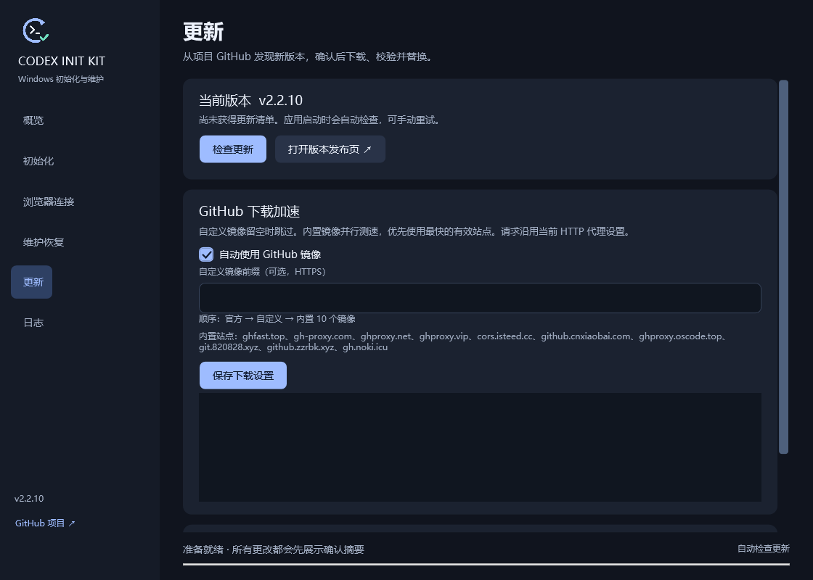

# GitHub 自动镜像

在“更新”页的“GitHub 下载加速”中设置，默认开启。顺序为官方 → 自定义 → 内置 10 个镜像。自定义留空时跳过。官方和自定义均未完成时，并行探测内置站点，最长等待 8 秒。通过内容检查的响应按耗时排序，下载或校验失败时换下一站。关闭自动镜像后仅使用官方地址。

内置候选分为两组，实际请求时一起测速。

- 社区公开清单与服务记录中常见的候选为 `ghfast.top`、`gh-proxy.com`、`ghproxy.net`、`ghproxy.vip` 和 `cors.isteed.cc`。[开源加速清单](https://github.com/XIU2/UserScript/wiki/Github-%E5%A2%9E%E5%BC%BA-%E9%AB%98%E9%80%9F%E4%B8%8B%E8%BD%BD) · [服务方记录](https://ghproxy.vip/)
- 按本项目更新清单和安装包实测选入 `github.cnxiaobai.com`、`ghproxy.oscode.top`、`git.820828.xyz`、`github.zzrbk.xyz` 和 `gh.noki.icu`。站点使用人数没有统一公开统计，实际可用性随资源、网络和代理变化。

自定义输入示例：`https://example.com/proxy/`。工具在前缀后拼接完整官方 URL。仅接受 HTTPS，可包含路径，不接受账号密码、查询参数或片段。点击“保存下载设置”后保存在 `%LOCALAPPDATA%\CodexInitKit\Desktop\network.json`，下次启动检查更新前加载。初始化 RTK 下载与桌面自身更新共用设置。

覆盖桌面工具直接控制的公开 GitHub 版本查询、更新清单、EXE 和 RTK 下载；独立脚本单独运行、微软商店、OpenAI 官方安装器内部的网络行为保持原样。不改系统代理、Git 配置或 GitHub 登录，也不把凭据发送给镜像。HTTP 代理开关仍以初始化页面为准，镜像不会绕过所选代理。

官方元数据请求最多等待 12 秒。镜像测速读取完整元数据并检查格式，安装包最多读取前 4 KiB。正式下载每站最多 5 分钟，连接或读取连续 30 秒无响应则切换。失败的候选文件会清理。

GitHub 官方提交接口返回 HTTP 403 或 429 时，先读取本项目 `main` 的 GitHub 官方更新清单。该清单也无法读取时，再尝试镜像。其他错误下，仍优先使用提交查询；查询在所有通道均未完成时，改读公开更新清单。所有通道使用相同的仓库、版本、下载地址和 SHA-256 校验。RTK 先获取校验清单，再下载并校验 ZIP。更新日志记录站点、测速耗时、失效原因和切换结果。

