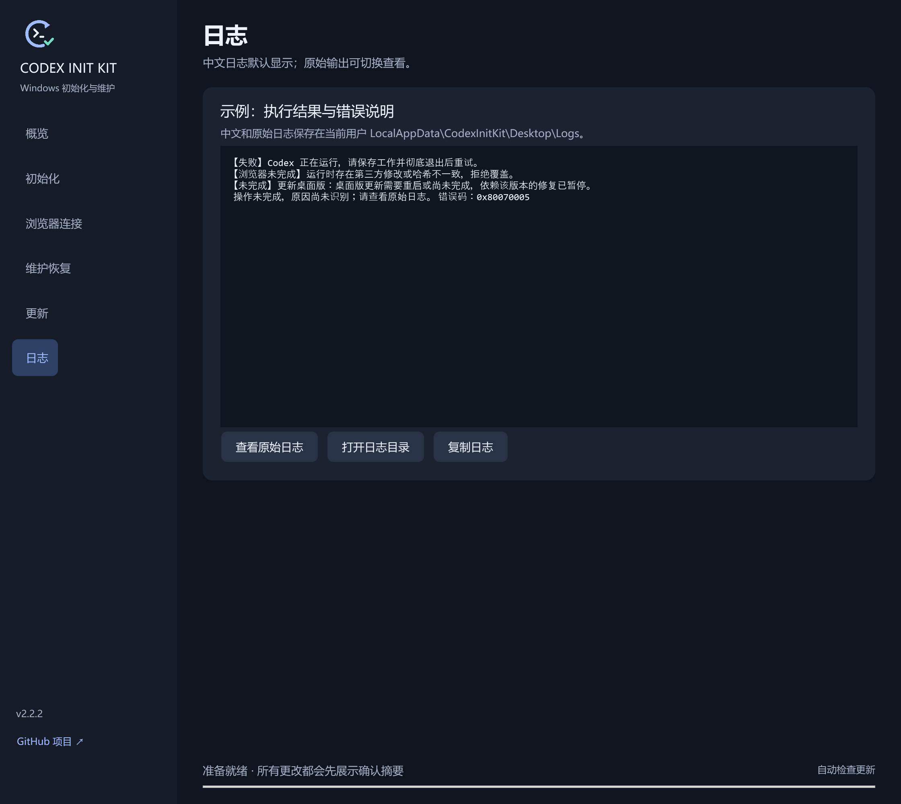

# 中文日志与原始日志（2.2.2）

桌面版的错误日志、弹窗、修复结果和更新错误默认使用中文。工具自身的已知错误会给出具体说明；Windows、Codex、winget 等程序的常见错误提供本地中文解释。未知错误会明确提示“原因尚未识别”，可查看原始日志继续排查。路径、错误码、模型 ID 等技术信息保留原样。

在「日志」页点击「查看原始日志」可查看未经翻译的完整输出，点击「查看中文日志」可切回中文。「复制日志」复制当前显示的内容。每次开始新的操作时默认显示中文。

日志保存在 `%LOCALAPPDATA%\CodexInitKit\Desktop\Logs`：

| 文件 | 内容 |
| --- | --- |
| `<任务编号>.zh-CN.log` | 桌面界面生成的中文说明 |
| `<任务编号>.log` | 原始后台输出，包含诊断记录 |
| `ui-<编号>.zh-CN.log`、`ui-<编号>.log` | 界面异常的中文说明和原始异常 |
| `update.zh-CN.log`、`update.log` | 程序退出后执行自身更新时的中文和原始记录 |

原始内容继续用于故障判断，查看或切换语言不会改变操作结果。解释在本地完成，不调用在线翻译服务。历史日志继续保留；独立脚本的输出语言不属于这次桌面中文化范围。

