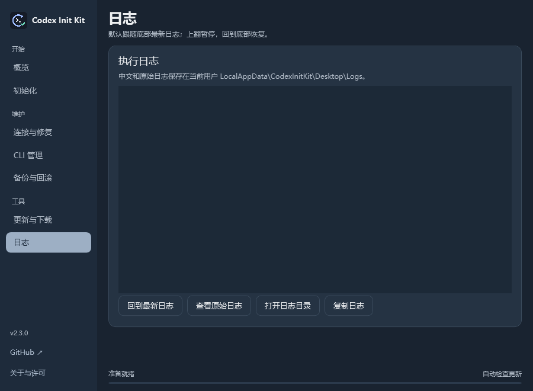

# 中文日志与原始日志（2.3.0）

桌面版的错误日志、弹窗、修复结果和更新错误默认使用中文。工具自身的已知错误会给出具体说明；Windows、Codex、winget 等程序的常见错误提供本地中文解释。未知错误会明确提示“原因尚未识别”，可查看原始日志继续排查。路径、错误码、模型 ID 等技术信息保留原样。

在「日志」页点击「查看原始日志」可查看未经翻译的完整输出，点击「查看中文日志」可切回中文。「复制日志」复制当前显示的内容。每次开始新的操作时默认显示中文。

日志默认停在底部显示最新内容。上翻后暂停跟随，新增内容不会把阅读位置拉走；回到底部或点击“回到最新日志”恢复跟随。初始化执行页的“执行详情”中使用相同行为；默认折叠，点击“回到最新日志”会展开并恢复跟随。切换页面或中文 / 原始日志保留跟随状态，开始新操作时重新跟随。

桌面版自动更新可能因网络或商店服务暂时不可用而失败，这种情况无需担心；可以自行在微软商店或 Codex 内手动更新。本次失败仍标记为未完成，不代表更新成功。错误码 `0x80072EFD / -2147012867` 表示无法连接更新服务，可检查网络和代理；不自动修改系统代理。

日志保存在 `%LOCALAPPDATA%\CodexInitKit\Desktop\Logs`：

| 文件 | 内容 |
| --- | --- |
| `<任务编号>.zh-CN.log` | 桌面界面生成的中文说明 |
| `<任务编号>.log` | 原始后台输出，包含诊断记录 |
| `ui-<编号>.zh-CN.log`、`ui-<编号>.log` | 界面异常的中文说明和原始异常 |
| `update.zh-CN.log`、`update.log` | 程序退出后执行自身更新时的中文和原始记录 |

原始内容继续用于故障判断，查看或切换语言不会改变操作结果。解释在本地完成，不调用在线翻译服务。历史日志继续保留；独立脚本的输出语言不属于这次桌面中文化范围。

“找不到可用的升级”配合 winget 的无更新退出码及正常安装包状态，会显示“当前软件源没有更新”。如果内置 CLI 运行版本探针被 Windows 拒绝访问，但官方包和必需组件签名正常，会单独显示权限说明并继续；不将未完成的运行验证写成通过。未勾选的初始化项目记为“已跳过”，不再作为最终失败项。

「更新与下载」中的 GitHub 请求记录显示当前站点、失败原因与下一通道；本工具自身更新的记录在更新页查看，初始化 RTK 下载记录保存在操作日志中。
