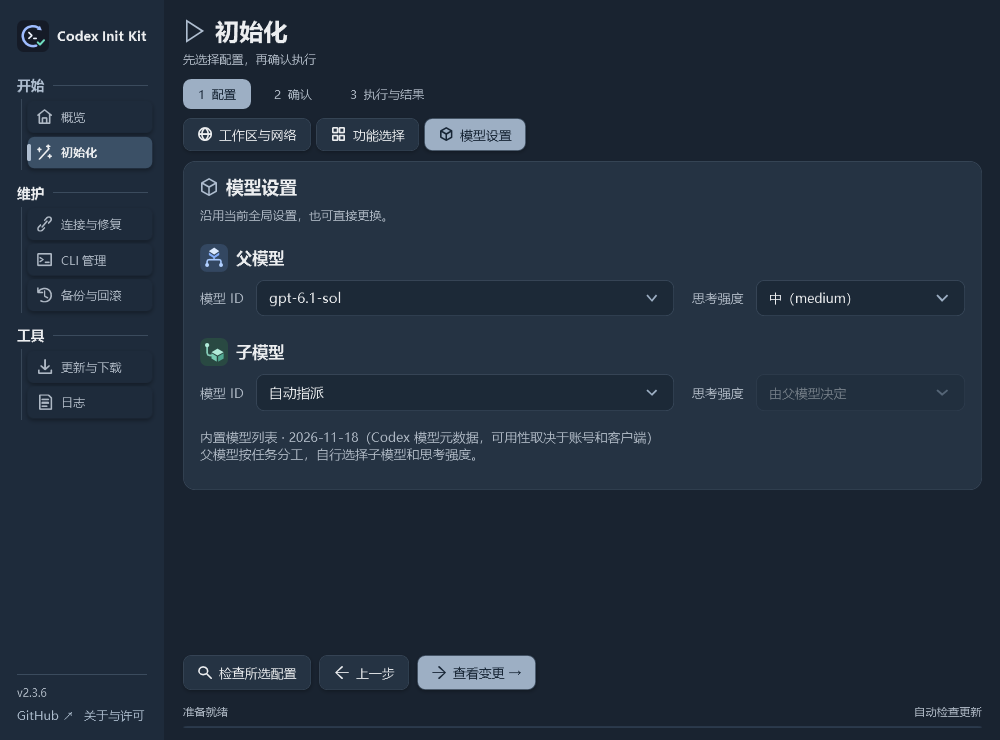

# v2.3.6 · 子代理自动指派

- 开启「子代理多线程」后，可以把分工交给父模型。在「模型设置」选择「自动指派」，思考强度会显示「由父模型决定」。选择具体子模型即可手动调整档位。
- 初始化会记住多线程开关、指派方式和手动档位。已有设置会沿用；首次使用且没有子模型配置时，默认自动指派。
- 父模型和子模型分别使用蓝色分支和薄荷绿节点图标。左下角的 GitHub 和「关于与许可」并排显示，应用图标的箭头也已对齐。
- 底部加载条会完整滑入、滑出。检查中途拉宽窗口，亮条也会走到新的右边缘。

