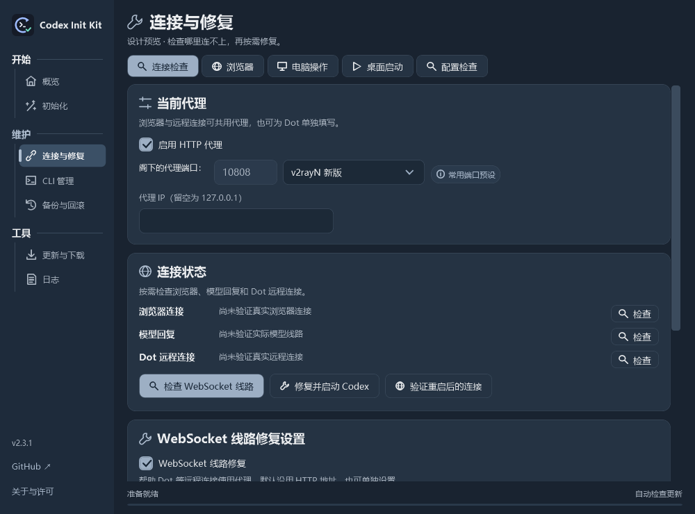
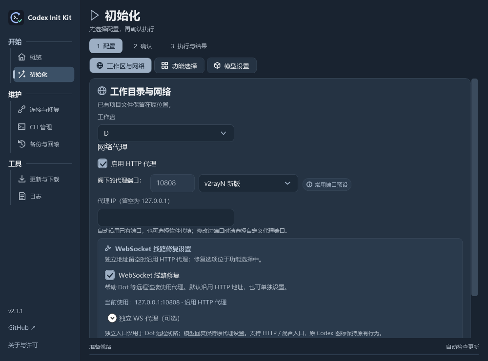

# WebSocket 线路修复

本功能帮助 Codex 的 Dot 远程连接使用已填写的代理，并提供浏览器、模型回复和远程连接的分项检查。HTTP 代理也能承载 WebSocket，不需要把代理地址写成 ws://。

## 代理怎样填写

- 默认勾选“WebSocket 线路修复”，WS 的 IP 和端口默认留空，分别沿用 HTTP 对应值。
- 只改 WS 端口时，IP 可以留空。关闭 HTTP 代理后，需要完整填写独立 WS 的 IP 和端口。
- 使用 HTTP／混合代理入口。节点设置里的 WebSocket 传输端口、纯 SOCKS5 端口不能直接填作 HTTP 代理。
- 页面会显示最终使用的地址及来源。初始化与连接检查页的设置保持同步。
- 设置保存到本工具的本地文件；不会写入 Codex 不识别的 WS_PROXY／WSS_PROXY。

## 怎样使用

1. 打开“连接与修复”→“连接检查”，核对代理地址。
2. 点击“检查 WebSocket 线路”，检查隧道、握手及连续回显。测试站不可用时会尝试备用站。
3. 点击模型回复旁的“检查”，运行官方 CLI 的只读网络诊断，不创建对话或发送任务。
4. 保存工作，确认此前没有未结清的远程请求，再点击“修复并启动 Codex”。有相关进程时，程序先询问是否允许关闭，默认取消。
5. 启动后点击“验证重启后的连接”，再通过 Dot 读取对话，确认实际功能恢复。

工具不会因为端口可达、HTTP 401／403、保存成功或请求启动成功，就显示远程连接已修好。模型探针通过也不代表当前对话正在使用 WS，实际传输仍需结合该对话日志。

## 独立 WS 地址与原生组件

共用 HTTP 地址时，不启动转发组件。独立地址不同时，工具才启动本机 C# 转发组件，按 Dot 的远程目标分流，其余目标保持原定 HTTP 路线。

独立设置首版用于 Dot 远程目标，模型回复保留 HTTP 代理及 Codex 原有的 WS／HTTPS 回退机制。这里按目标区分线路，不解密连接内容。

组件只监听本机随机端口，随对应 Codex 主进程退出。无需驱动、TUN、虚拟网卡、证书、系统服务或开机启动项。官方安装文件和系统代理不被修改。官方应用通过 Windows 原生包查询接口定位，读取当前包注册的主程序执行别名，并检查当前版本是否具备环境代理入口。启动使用官方别名传入本次代理环境；别名不可用时在关闭应用前停止。

通过本工具“修复并启动”后生效，原 Codex 图标保持原有行为。若当前版本无法识别、启动失败或未获得真实连接证据，会明确显示未完成或待验证。

## 撤销

先退出由本工具启动的 Codex，再点击“撤销 WebSocket 线路修复”。工具恢复修复前保存的本地 WS 设置；重复撤销不会删除已恢复的设置。HTTP 配置、对话和项目文件保留。

## 安全软件提示

本功能仍可能受到安全软件的进程启动或网络行为检查。发生拦截时，记录时间、程序名称及具体提示，再反馈排查。工具不会自动修改防护规则。

## 本地验证

详见[验证报告](Validation-2.3.1.md)。2026-11-16，本机通过官方启动别名和共用代理 127.0.0.1:3067 重启后，Dot 原生列表及读取验收通过，本机日志和自动诊断也确认远程已连接。此结果限于本次环境和只读功能；独立入口的官方应用端到端验收、发送、长期稳定性及跨实体显示器 DPI 切换仍需分别验证。

火绒“安全日志”中的“已阻止”是历史处理记录，不能在该窗口事后同意。它与实时允许／阻止弹窗不同。若没有弹窗，先记录拦截详情，避免反复执行同一步；不要把拦截当作仍在等待确认。
